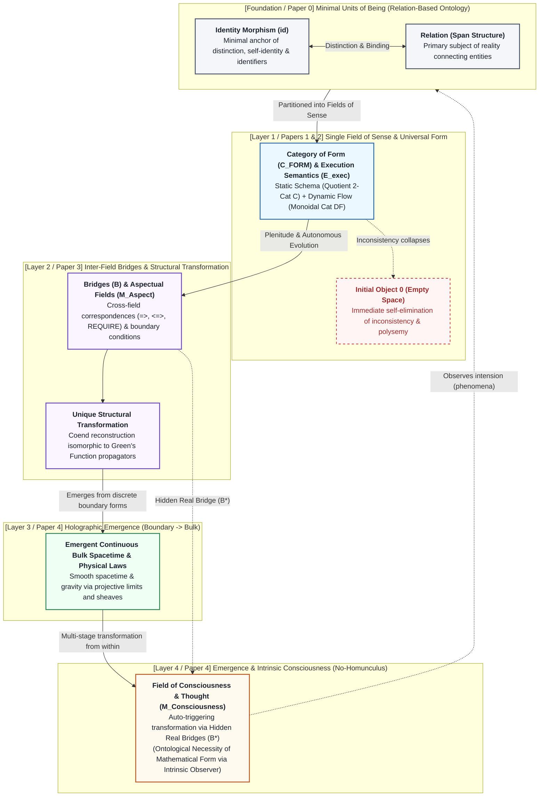

# Ordo Forma Est: Relation-Based Ontology and a Category-Theoretic Formalization of General Modeling Methodologies

- Date : 2026/11/26
- Version : 1.4.0

[English](README.md) | [日本語](README.ja.md)

This repository serves as the central archive for a five-part research program dedicated to formalizing the universal foundations of "general modeling methodologies"—spanning everyday linguistic understanding, theoretical descriptions in the natural sciences, and conceptual information modeling—through the lens of **Category Theory**.

---

## 1. Research Vision and Background

Traditional philosophy of language and general modeling methodologies have predominantly relied on an **object-based paradigm**, treating objects ("things") as foundational and relations as secondary attributes attached between them. However, this object-based view cannot fundamentally explain how linguistic polysemy leads to the collapse of meaning, how structural transformations operate across distinct contexts (*Fields of Sense*), or how human beings with finite cognitive resources asymptotically approach rigorous models of reality.

Starting from a **relation-based ontology**—which posits that relations (*span structures*) themselves constitute the primary subjects of reality—this research program builds a unified theoretical architecture across five papers (**Paper 0 – Paper 4**), progressing from foundational ontology and epistemology to the mathematical rigor of static and dynamic modeling, and finally to the metaphysics of emergence.

### Conceptual Foundation
This research program builds upon the practical and structural principles of conceptual modeling articulated in [*Conceptual Modeling Principle*](https://github.com/kae-made/conceptual-modeling-articles/blob/main/Conceptual-Modeling-Principle.pdf), aiming to provide these principles with a rigorous, self-contained mathematical formalization via Category Theory.

---

## 2. Publication Roadmap (Paper 0 – Paper 4)

The series is structured into two tiers: rigorous mathematical and engineering formalizations (**Papers 0–3**), followed by their philosophical and cosmological implications (**Paper 4**).

### [Paper 0] Foundational Ontology and Epistemology *(Published — Nov 16, 2026)*
* **Title:** *Relation-Based Ontology and a Category-Theoretic Formalization of Fields of Sense: Structural Collapse via Linguistic Polysemy and Phenomena as the Intension of a Universe*
* **DOI:** [`10.5281/zenodo.24267213`](https://doi.org/10.5281/zenodo.24267213) (v1.0.0 English Version: [`https://doi.org/10.5281/zenodo.24267213`](https://doi.org/10.5281/zenodo.24267213))
* **Files:**
  * English Version: `papers/RelationBasedOntology-and-a-CategoryTheoreticFormalization-of-FieldsOfSense.pdf`
  * Japanese Version: `papers/RelationBasedOntology-and-a-CategoryTheoreticFormalization-of-FieldsOfSense.jp.pdf`
* **Summary:** Demonstrates that relation-centered span structures constitute the essence of meaningful existence. Formalizes how linguistic polysemy collapses meaning into trivial identity morphisms, and shows how reality is partitioned into schema-governed *Fields of Sense* connected via *Bridges* (restricted exclusively to objects and feature values) to form a *Universe* $\mathcal{U}$. Proves that observed phenomena are the *intension* of this Universe and that uniquely inverting the global structure of $\mathcal{U}$ from observation is impossible in principle.

### [Paper 1] Static Modeling Theory: Rigorous Schema Representation and Asymptotic Refinement *(Published - Nov 19, 2026)*
* **Title:** *Category-Theoretic Foundations of Conceptual Information Modeling: Rigorous Schema Representation, Isomorphism, and Asymptotic Refinement under Cognitive Finitude*
* **DOI:** [`10.5281/zenodo.24359112`](https://doi.org/10.5281/zenodo.24359112) (v1.0.1 English Version: [`https://doi.org/10.5281/zenodo.24359112`](https://doi.org/10.5281/zenodo.24359112))
* **Files:**
 * English Version: `papers/CategoryTheoreticFoundationsOfCIM.pdf`
 * Japanese Version: `papers/CategoryTheoreticFoundationsOfCIM.ja.pdf`
* **Summary:** Derives the necessary conditions required for the Universe $\mathcal{U}$ in Paper 0 to exist consistently, demonstrating that these conditions correspond directly to the core constructs of conceptual information modeling: data types, single and composite identifiers (monomorphisms), referential attributes (commutative factorizations), bidirectional relations with phrases and multiplicities (spans), and associative entities (multispans). Shows that modeling is not "vagueness" but the specification of concrete and rigorous structures. Proves that adequate models of the same Field of Sense are mutually isomorphic (categorically equivalent), and formalizes how finite human cognition asymptotically approaches the true schema via subclassing (resolving `0..1` and `Nullable` ambiguities) and relational integration.

### [Paper 2] Dynamic Process Theory: Monoidal Categorical Dynamics of State and Action Models *(Published - Nov 22, 2026)*
* **Title:** *Category-Theoretic Foundations of Dynamic Modeling: State Transitions, Data-Flow Action Models, Universal Execution Semantics, and Isomorphism with Physical Field Theories*
* **DOI:** [`10.5281/zenodo.24430915`](https://doi.org/10.5281/zenodo.24430915) (v1.0.0 English Version: [`https://doi.org/10.5281/zenodo.24430915`](https://doi.org/10.5281/zenodo.24430915))
* **Files:**
 * English Version: `papers/CategoryTheoriticFondationsOfDynamicModeling.pdf`
 * Japanese Version: `papers/CategoryTheoriticFondationsOfDynamicModeling.ja.pdf`
* **Summary:** Introduces boundary conditions (pre- and post-conditions), external entities as boundary interfaces, and data-flow operators over rigorously defined data types. Integrates state models (aspectual Fields of Sense per state) with action models (state transitions), proving that states and transformations form a **Monoidal Category**. Demonstrates how discrete state-action models can faithfully describe continuous change through threshold-driven phase transitions and internal parameter trajectories.

### [Paper 3] Structural Transformation Theory: Transformations Across Fields of Sense *(Published - Nov 22, 2026)*
* **Title:** *Category-Theoretic Foundations of Structural Transformation: Bridges as Fields of Sense, Boundary Conditions via Aspectual Fields of Sense, and Isomorphism with Green's Functions*
* **DOI:** [`10.5281/zenodo.24431232`](https://doi.org/10.5281/zenodo.24431232) (v1.0.0 English Version: [`https://doi.org/10.5281/zenodo.24431232`](https://doi.org/10.5281/zenodo.24431232))
* **Files:**
 * English Version: `papers/CategoryTheoriticFondationsOfStructuralTransformationTheory.pdf`
 * Japanese Version: `papers/CategoryTheoriticFondationsOfStructuralTransformationTheory.ja.pdf`
* **Summary:** Extends the framework from intra-field dynamics (Papers 1–2) to structural transformations across distinct schemas (Fields of Sense) and aspects. Formalizes the exact boundary conditions required for cross-field transformations via bridges, as well as the laws of structural preservation and information loss.

### [Paper 4] Cosmological Scope, Emergence, and Ontological Necessity *(Published — Nov 25, 2026)*
* **Title:** *Ordo Forma Est: The Holographic Structure of Spacetime, Emergence, and Consciousness, and the Ontological Necessity of Mathematical Form*
* **DOI:** [`10.5281/zenodo.24517932`](https://doi.org) (v1.0.0 English Version: [`https://doi.org`](https://doi.org))
* **Files:**
  * English Version: `papers/OrdoFormaEst-HolographicStructure-and-OntologicalNecessity.pdf`
  * Japanese Version: `papers/OrdoFormaEst-HolographicStructure-and-OntologicalNecessity.ja.pdf`
* **Summary:** Integrates the entire framework into the unified categorical architecture $\mathfrak{U}_{\mathrm{OFE}}$ and demonstrates that the formal structures of conceptual modeling constitute the universal ontological form (*Ordo Forma Est*) by which reality itself exists. Establishes four culminating theorems: (1) **Self-Selection of Form**, showing that inconsistent structures collapse into the initial object $0$ while consistent trajectories autonomously evolve under $\mathcal{E}_{\mathrm{exec}}$; (2) **Holographic Isomorphism**, proving that the emergence of continuous bulk spacetime from discrete relational forms on a low-dimensional boundary screen is categorically isomorphic to the **Holographic Principle**; (3) **Emergence and Consciousness without a Homunculus**, formulating phase transitions as horizontal field-switching and emergence/consciousness as auto-triggering structural transformations via hidden real bridges ($\mathcal{B}^*$), thereby demarcating physical actuality from autonomous fictional worlds and establishing categorical criteria for artificial consciousness; and (4) **Ontological Necessity of Mathematical Form**, resolving Wigner's puzzle from an intrinsic observer standpoint while exercising strict *epoché* (suspension of judgment) regarding the ultimate origin of the primordial boundary screen.

### Structure of Paper 0 ～ 4

---

## 3. Author & Contact

* **Hiroshi Ota (太田 寛)** — Knowledge & Experience / Independent Researcher
* **Homepage:** https://www.kae-made.jp
* **Research Notes:** https://note.com/kae_made
* **Ongoing Discussions & Thought Process (Membership):** https://note.com/kae_made/membership *(Sharing the ongoing development of ideas and open discussions)*
* **Research Ecosystem (Reference Toolset — COGITO):** https://github.com/kae-made/cogito *(Conceptual Modeling and Translative Generation Integrated Toolset)*
* **Contact:** master@kae-made.jp
